<div align="center">

<picture>
  <source media="(prefers-color-scheme: dark)" srcset="docs/readme/banner-dark.png">
  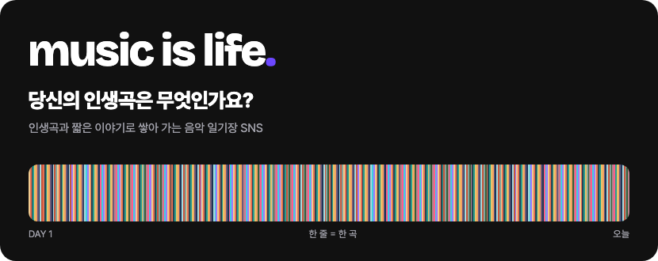
</picture>

<br><br>


</div>

> **"당신의 인생곡은 무엇입니까?"**
>
> 음악을 좋아하는 사람이라면 누구나 한 번쯤 다른 사람의 인생곡이 궁금했을 거예요.
> Music is Life는 인생곡과 그 곡에 얽힌 짧은 이야기를 나누고, 하루하루의 기록이 한 사람의 **음악 일기장**으로 쌓이는 SNS예요.

<details>
<summary>기획 의도 전문 보기</summary>

<br>

음악을 좋아하는 사람들에게 음악이란 인생의 정말 중요한 부분을 차지한다.

각자 좋아하는 음악 장르가 다르고, 같은 장르여도 좋아하는 멜로디나 박자 등의
세심한 차이가 각자의 **개성 있는 플레이리스트**를 탄생시킨다.

**다른 사람의 인생곡은 무엇일까?**

음악을 좋아한다면 누구나 한 번쯤은 가졌을 생각이다.
내가 들어보지 못한 곡은 너무나 많고, 내가 모르는 가수 또한 무수히 많다.

음악은 정답이 없으며, 그러한 정답 없는 세상에서
조그만 **커뮤니티 공간**을 만들어 음악의 경험과 소통을 제공하고자 한다.

**"음악은 내 삶이다"** 라는 속된 말과 같이 음악 없이 못 사는 사람들을 위해
**Music is Life**가 그들의 갈증을 조금이나마 해소하길 바란다.

</details>

## 이렇게 동작해요

<p align="center">
  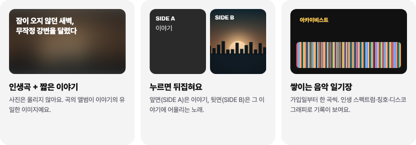
</p>

- **인생곡 + 짧은 이야기**: 사진은 올리지 않아요. 곡의 앨범 아트가 이야기의 유일한 이미지예요.
- **누르면 뒤집혀요**: 카드 앞면(SIDE A)은 이야기, 뒷면(SIDE B)은 그 이야기에 어울리는 노래예요.
- **쌓이는 음악 일기장**: 가입일부터 한 곡씩 쌓인 기록이 인생 스펙트럼, 칭호, 디스코그래피로 보여요.

## 화면

사용자가 이동하는 순서대로 놓았어요.

<table>
  <tr>
    <td align="center">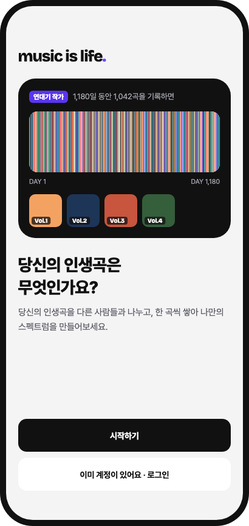<br><b>웰컴</b><br><sub>당신의 인생곡은 무엇인가요?</sub></td>
    <td align="center">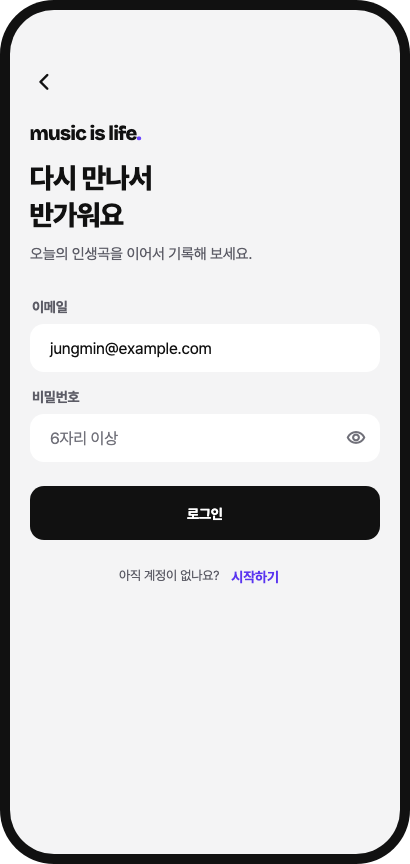<br><b>로그인</b><br><sub>다시 만나서 반가워요</sub></td>
    <td align="center">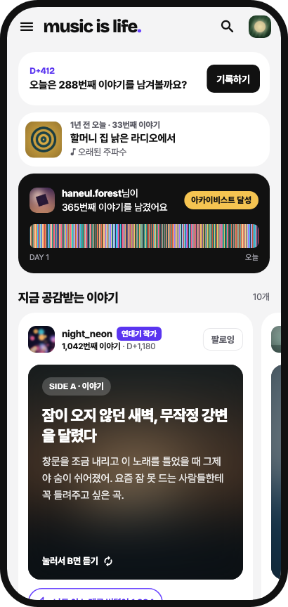<br><b>홈</b><br><sub>오늘의 기록 · 지금 공감받는 이야기</sub></td>
  </tr>
  <tr>
    <td align="center">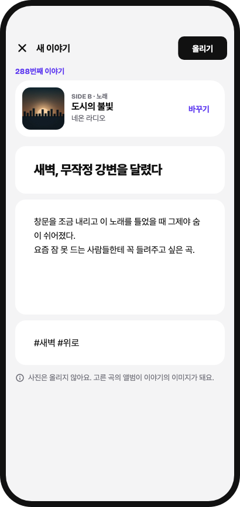<br><b>이야기 쓰기</b><br><sub>곡 하나 + 짧은 이야기</sub></td>
    <td align="center">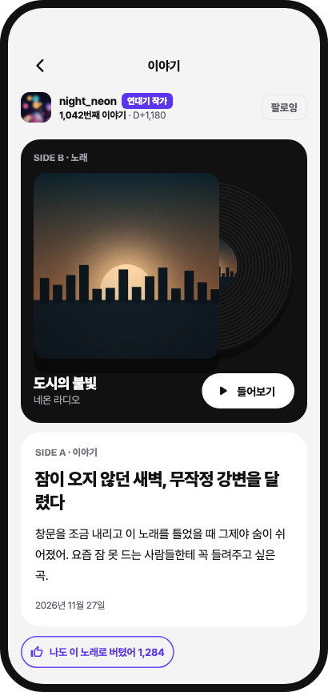<br><b>이야기 상세</b><br><sub>SIDE B 노래 · SIDE A 이야기</sub></td>
    <td align="center">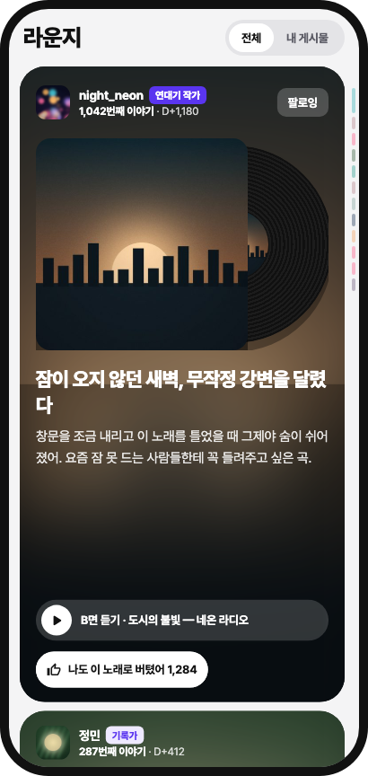<br><b>라운지</b><br><sub>세로로 넘기는 이야기 피드</sub></td>
  </tr>
  <tr>
    <td align="center">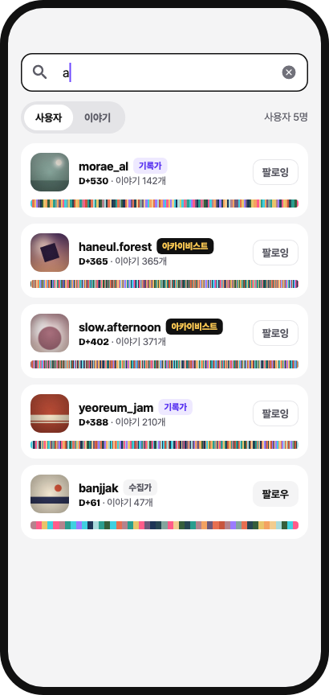<br><b>검색</b><br><sub>칭호와 인생 스펙트럼</sub></td>
    <td align="center">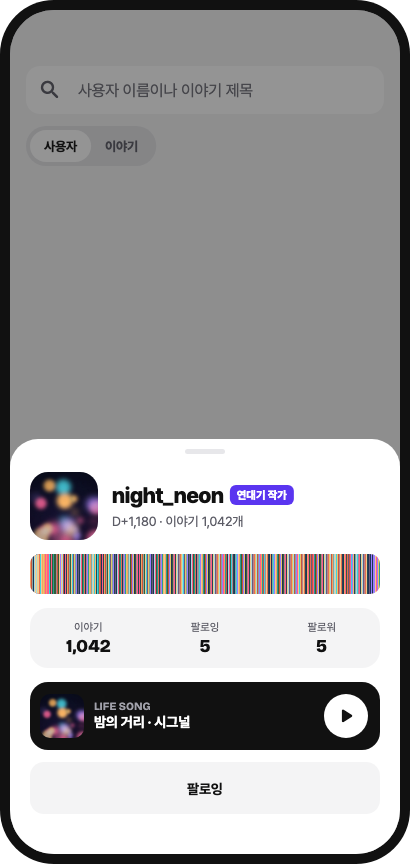<br><b>미니 프로필</b><br><sub>인생곡 앨범 · 스펙트럼 · 팔로우</sub></td>
    <td align="center">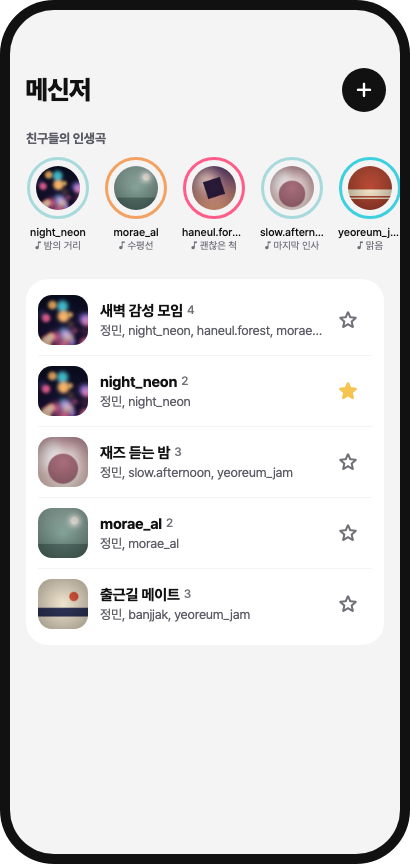<br><b>메신저</b><br><sub>친구들의 인생곡</sub></td>
  </tr>
  <tr>
    <td align="center">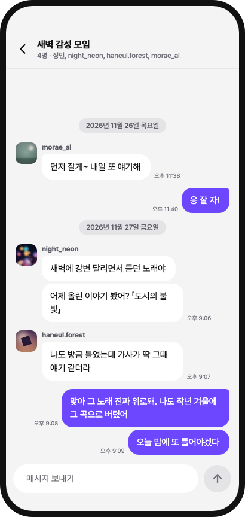<br><b>채팅방</b><br><sub>날짜별 대화 · 인생곡 앨범</sub></td>
    <td align="center">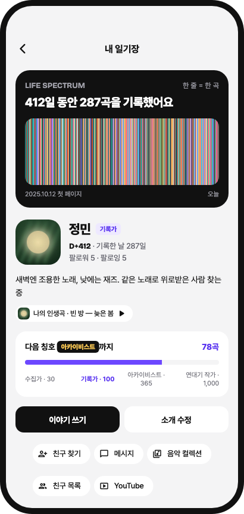<br><b>내 일기장</b><br><sub>스펙트럼 · 디스코그래피 · 타임라인</sub></td>
    <td align="center">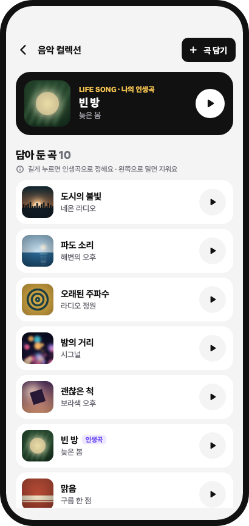<br><b>음악 컬렉션</b><br><sub>나의 인생곡 · 담아 둔 곡</sub></td>
  </tr>
</table>

<sub>* 화면 이미지는 실제 앱 화면을 예시 데이터로 그린 것이에요. 이 밖에 회원가입·곡 고르기·채팅방 만들기·친구 찾기·친구 목록·YouTube에서 찾기 화면이 있어요.</sub>

## 기록이 쌓이면

칭호는 인기도가 아니라 **쌓은 기록 수**로 올라요. 오래, 꾸준히 기록한 사람이 가장 빛나요.

| 칭호 | 기준 | 의미 |
|---|---|---|
|  | 이야기 30개 | 음악 일기장을 시작한 사람 |
|  | 이야기 100개 | 꾸준히 기록을 쌓는 사람 |
|  | 이야기 365개 | 1년치 인생곡을 모은 사람 |
|  | 이야기 1,000개 | 음악으로 연대기를 쓴 사람 |

## 디자인

<p align="center">
  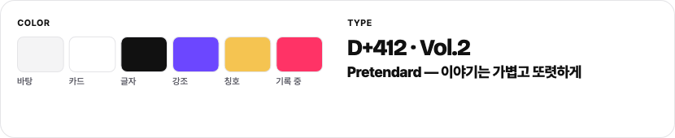
</p>

색·글자·간격·모서리는 디자인 토큰(`lib/core/theme/tokens/`)으로, 칭호 배지·인생 스펙트럼·SIDE A/B 카드 같은 공용 컴포넌트는 `lib/core/widgets/components/`에 있어요.

## 기술 스택

| 분야 | 사용 기술 |
|---|---|
| 앱 | Flutter 3.44 · Dart 3.12 · GetX |
| 백엔드 | Firebase Auth · Cloud Firestore · Cloud Messaging |
| 음악 | Spotify Web API (PKCE 로그인) · YouTube 영상 재생 |
| 디자인 | Pretendard · Bricolage Grotesque · 자체 디자인 토큰 |
| 테스트 | flutter_test · fake_cloud_firestore |

기능마다 `domain / data / presentation`으로 나눈 클린 아키텍처예요. 자세한 내용은 [docs/ARCHITECTURE.md](docs/ARCHITECTURE.md)에 있어요.

```
lib/
├── core/           # 테마·디자인 토큰, 공용 컴포넌트, 라우터, Result/Failure
└── features/
    ├── auth/       # 웰컴·로그인·회원가입
    ├── contents/   # 이야기(게시물)·라운지
    ├── home/       # 홈 피드
    ├── profile/    # 내 일기장(마이페이지)
    └── search/ · messenger/ · friends/ · music/
```

README 이미지는 앱의 실제 글꼴과 컴포넌트로 그려요. 화면이 바뀌면 `flutter test tool/readme --update-goldens`로 다시 만들 수 있어요.

## 📒 개발 일지

<!-- DEVLOG:START -->
| 날짜 | 작업 |
|---|---|
| 2026-11-25 | 🚩 리디자인: "쌓이는 음악 일기장" 콘셉트로 전 화면 교체 |
| 2026-11-18 | 🚩 v2.1.0 배포: 클린 아키텍처 전환 완료 |
| 2026-11-17 | 운영 데이터 uid 전환, 보안 규칙 강화, 인증·프로필·게시물 이전 |
| 2026-11-17 | iOS 실기기 설치 |
| 2026-11-17 | 🚩 v2.0.0: Flutter 3.44 업그레이드와 브랜치 전략 도입 |

→ [전체 개발 일지 보기](docs/DEVLOG.md)
<!-- DEVLOG:END -->

<details>
<summary>v1 데모 영상 보기 (2023 ~ 2024, 리디자인 이전)</summary>

<br>

<div align="center">


</div>

#### 회원가입

https://github.com/Astrum93/Flutter_Music_Is_Life/assets/116700688/9de50ca9-02e5-4f6e-96f2-c172263eb05d

#### 로그인

https://github.com/Astrum93/Flutter_Music_Is_Life/assets/116700688/63c08e95-5897-4b00-865f-15689a15a622

#### 홈

https://github.com/Astrum93/Flutter_Music_Is_Life/assets/116700688/6e74780b-5242-492f-958a-8e521e1d256d

#### 마이페이지

https://github.com/Astrum93/Flutter_Music_Is_Life/assets/116700688/0da517c4-feb8-47ae-b52d-65eca3edd535

#### 게시물 생성

https://github.com/Astrum93/Flutter_Music_Is_Life/assets/116700688/77a96401-00dc-4370-a72b-454dae8fc7af

#### 음악 검색

https://github.com/Astrum93/Flutter_Music_Is_Life/assets/116700688/e1c15d06-f535-4389-a98f-a87d2ad4959d

#### 검색

https://github.com/Astrum93/Flutter_Music_Is_Life/assets/116700688/b83e9a9c-6910-4b2d-9b00-500a1827fbb0

#### 라운지

https://github.com/Astrum93/Flutter_Music_Is_Life/assets/116700688/5237f3f0-4ba4-40f2-953f-292852f01329

#### 채팅

https://github.com/Astrum93/Flutter_Music_Is_Life/assets/116700688/fb007bbf-da34-4b5d-a11c-4b249a37391c

</details>

<br>

<p align="center"><sub>Developer NA · Since 2023.06.12 · Flutter로 만들었어요</sub></p>
